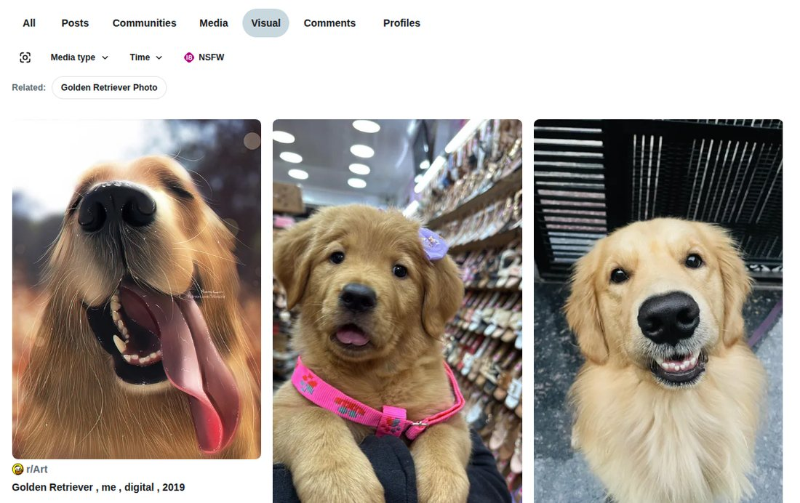
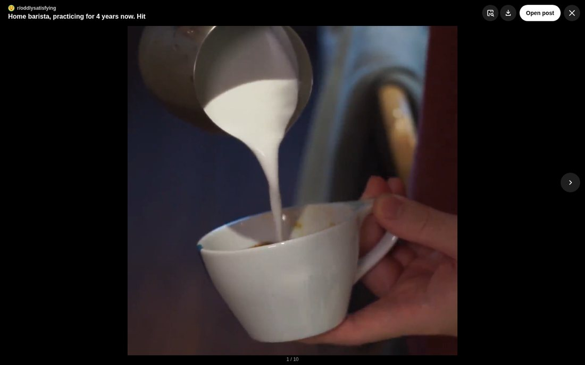
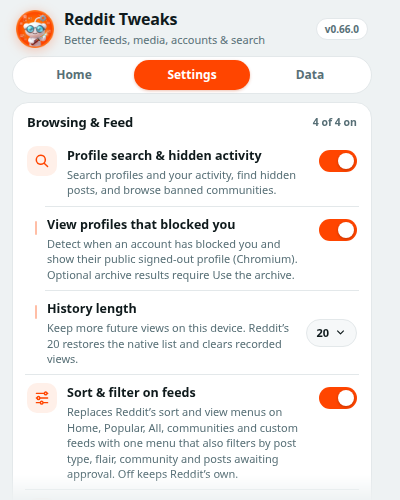
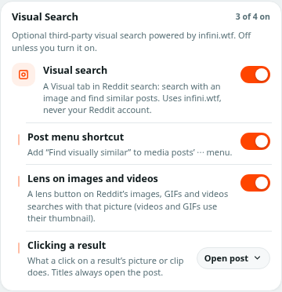

<p align="center">
  
</p>

<h1 align="center">Reddit Tweaks</h1>

<p align="center">
  Better feeds, media, search and accounts for Reddit on the web, on desktop and on your phone.
</p>

<p align="center">
  <a href="../../releases/latest"><b>Download</b></a> ·
  <a href="#features">Features</a> ·
  <a href="#install">Install</a> ·
  <a href="PRIVACY.md">Privacy</a> ·
  <a href="CHANGELOG.md">What's new</a>
</p>

<p align="center">
  
</p>

Reddit Tweaks is a browser extension that fills the gaps in Reddit's website. Search all your chats, filter any feed, decide how videos play, switch accounts in one click, and find posts by what they look like. It works inside Reddit's own pages and matches Reddit's design, so it feels like part of the site.

Every feature can be switched on or off from the toolbar popup. Anything that uses an outside service is off until you turn it on.

## Features

### Search

- **Chat search.** Search every Reddit chat and message, including old conversations Reddit no longer shows, by person, by words, or by date. Your messages are indexed on your device, not online.
- **Visual search.** A **Visual** tab in Reddit search finds images, GIFs and videos by what they look like. Search with your own picture (upload, paste or drag it in), or find posts that look like one you're viewing. Clips preview as you hover or scroll, and open in a full-screen viewer.
- **Profile search and hidden activity.** Search anyone's posts and comments, find posts hidden from profiles, and see profiles that have blocked you.
- **History.** Keep far more than Reddit's last 20 viewed posts, stored only in your browser.

<p align="center">
  
</p>

### Feeds

- **One Sort & filter menu** on Home, Popular, All, communities and custom feeds. Filter by post type, flair, community or date, and see posts still awaiting approval.
- **Smooth scrolling** on long feeds, profiles, search results and comment threads, and Back returns you to where you were.
- **Clean shared links** without Reddit's tracking parameters.
- **On phones:** hide the "open in the app" prompts, and choose for each kind of page whether the top bar stays, hides as you scroll, or stays out of the way.

### Videos and media

- **Choose how media starts:** Reddit's default, autoplay, preview on hover (or the one you stop on, on phones), or only when you press Play. Videos, GIFs and embedded players (YouTube, Vimeo, Streamable and more) each have their own setting.
- **Seamless post transition.** A playing video carries on smoothly into its post.
- **Post opened directly.** Decide whether a post's own video starts muted, with sound, or paused.
- **Little things:** one video at a time, remembered volume, hold for 2× speed, looping, stream quality, and pause or keep playing when you scroll away.
- **Download media** from images, galleries, GIFs and videos.

<p align="center">
  
</p>

### Accounts and your content

- **Switch accounts** from Reddit's own account menu, or browse anonymously, without signing out.
- **Redaction.** Edit or delete your old posts and comments in bulk, with a review step before anything changes.
- **Your removed content.** See which of your posts and comments were removed or deleted, with an optional toolbar count.

### Archive (optional)

Powered by Arctic Shift, a public archive of Reddit. Turn on **Use the archive** to:

- restore deleted posts, comments, images and authors in place;
- browse banned and private communities;
- find activity Reddit no longer shows on profiles.

### Tools

- **Raffles.** Pick winners from a post's comments, right from its ⋯ menu.
- **Awaiting approval filter.** Show posts held for review in any community: your mod queue where you moderate, otherwise the archive.

<p align="center">
  
  &nbsp;&nbsp;
  
</p>

## Install

Reddit Tweaks isn't in the browser stores yet. Every [release](../../releases) has ready-made packages.

**Chrome, Edge, Brave and other Chromium browsers**

1. Download `reddit-tweaks-v….zip` from the [latest release](../../releases/latest) and unzip it.
2. Open `chrome://extensions` (or `edge://extensions`, `brave://extensions`) and turn on **Developer mode**.
3. Click **Load unpacked** and choose the unzipped folder.
4. Refresh any open Reddit tabs.

**Firefox (desktop and Android)**

Each release also has a Firefox build (`reddit-tweaks-firefox-v….zip`). Until it's listed on Firefox Add-ons, you can try it on desktop through `about:debugging` → **This Firefox** → **Load Temporary Add-on**, choosing the zip. Firefox removes temporary add-ons when it restarts.

**Updating:** download the new release, replace the folder's contents, then press the reload button on the extension's card and refresh Reddit.

## Privacy

Reddit Tweaks has no analytics and sends nothing to its developers. Your chats, history and settings stay in your browser. Optional features that use outside services (Arctic Shift for the archive, infini.wtf for Visual search, RedditRaffler for public raffles) are off until you choose them, and each says what it sends. See [PRIVACY.md](PRIVACY.md) for details.

## FAQ

**Is this made by Reddit?**
No. It's an independent extension and isn't affiliated with Reddit.

**Which Reddit does it work on?**
The current Reddit website (`www.reddit.com`), on desktop and mobile browsers. Old Reddit isn't supported.

**Do I need to be signed in?**
Most features work either way. Chat search, account switching, redaction and your removed content need you to be signed in.

**Something looks broken after Reddit changed its site.**
Please [open an issue](../../issues) with the page and what you expected to see.

## For developers

```bash
npm install          # test tools only; the extension has no runtime dependencies
npm test             # unit tests
npm run package      # builds artifacts/reddit-chat-search/ (load unpacked) and a zip
```

Building, testing, the release pipeline and how each feature works are covered in [docs/development.md](docs/development.md). The contribution workflow is in [AGENTS.md](AGENTS.md), and release notes are in [CHANGELOG.md](CHANGELOG.md).
