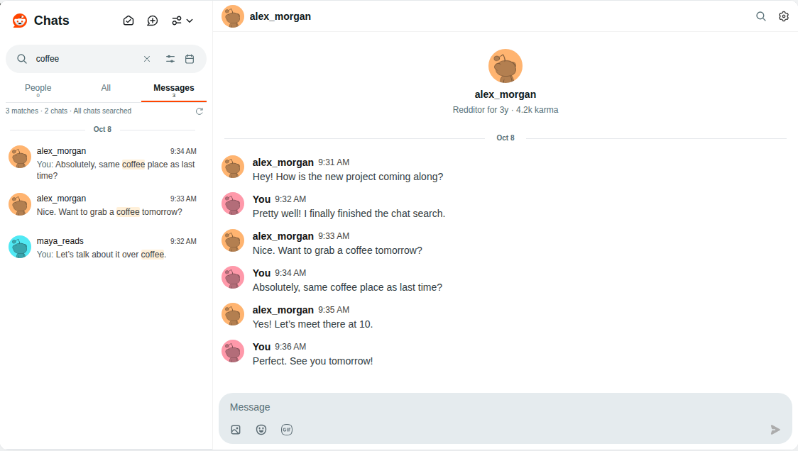
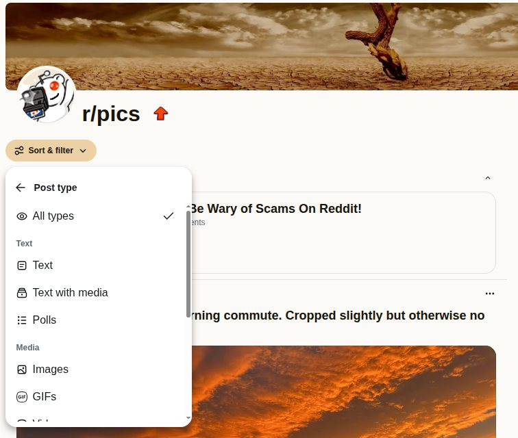
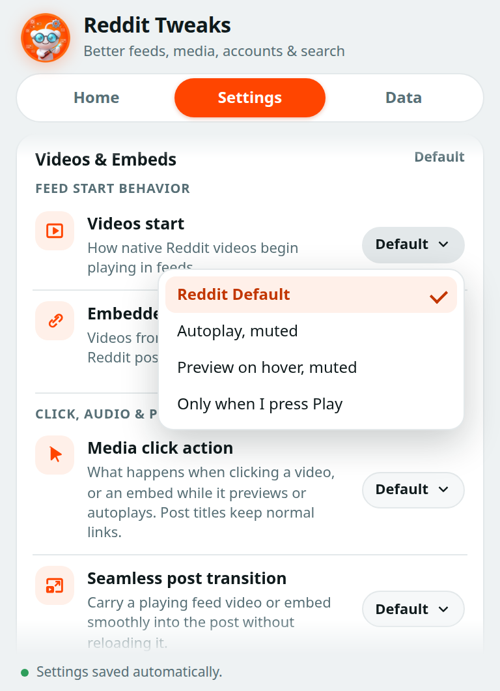

<p align="center">
  
</p>

<h1 align="center">Reddit Tweaks</h1>

<p align="center">
  <b>The Reddit website, finished.</b><br>
  Search every chat, filter any feed, decide how videos play, switch accounts, and bring back what Reddit hides.
</p>

<p align="center">
  <a href="../../releases/latest"><b>Download the latest release</b></a> ·
  <a href="#install">Install</a> ·
  <a href="#whats-inside">What's inside</a> ·
  <a href="PRIVACY.md">Privacy</a> ·
  <a href="CHANGELOG.md">Changelog</a>
</p>

<p align="center">
  
</p>

Reddit Tweaks is a free browser extension for **reddit.com** on Chrome, Edge, Brave and Firefox, on desktop and on your phone. It doesn't replace Reddit with a different app. It adds what's missing inside Reddit's own pages, styled like Reddit's own menus and buttons, so it feels like part of the site.

Everything is switched on or off from the toolbar popup, one feature at a time. The everyday improvements are on from the start. Anything that talks to a service outside Reddit stays off until you turn it on.

## What's inside

- [Chat search](#chat-search): find any message or person in your Reddit chats.
- [Feeds](#feeds): one Sort & filter menu for every feed, smoother scrolling, and Back that remembers your place.
- [Videos and media](#videos-and-media): your rules for how videos, GIFs and embedded players start, sound, loop and open.
- [Profiles and search](#profiles-and-search): search any profile, see hidden activity, keep a longer history, and use one search language everywhere.
- [Accounts and your content](#accounts-and-your-content): switch accounts, clean up your old posts, and see what was removed.
- [The archive](#the-archive-optional): restore deleted posts and comments, and open banned communities.
- [Visual search](#visual-search-optional): find posts by what they look like.
- [More tools](#more-tools): raffles, downloads, moderation, and phone-specific fixes.

## Chat search

Reddit's chat can only scroll back through what it has already loaded. Reddit Tweaks adds a real search box to the chat list, in full-page chat and in the floating chat window.

- **People, Messages or All.** Find a conversation by name, or find the message itself, with each match highlighted. Click a result to jump straight to it.
- **Every chat, not just recent ones,** including old conversations Reddit no longer shows in the list.
- **Filters** for who sent it (`from:me`, `from:alice`), what it contains (`has:image`, `has:link`) and when (`after:2026-10-01`, or the date picker).
- **Private by design.** Your messages are indexed on your own device as you use chat, never uploaded anywhere. You can see how much is stored, and clear it, from the popup's Data tab.

## Feeds



- **One Sort & filter menu** on Home, Popular, All, communities and custom feeds. It combines sort, view (card or compact) and filters:
  - **post type:** text, images, GIFs, videos, galleries, links, polls, embedded media and more;
  - **flair**, **community** and **date**;
  - **posts awaiting approval** in communities you moderate.
- **Smooth scrolling** on long feeds, profiles, search results and (in beta) long comment threads.
- **Back returns you to where you were,** with the same posts in the same place, instead of reloading the feed from the top.
- **Clean shared links** without Reddit's tracking parameters.

<br clear="right">

## Videos and media



Reddit decides when videos play and how loud. With Reddit Tweaks, you do:

- **How things start:** Reddit's default, autoplay muted, preview on hover (on phones, preview the one you stop on), or only when you press Play. Reddit videos, GIFs and players embedded from other sites each get their own setting.
- **What a click does:** play in place, open the post, or go full screen, with or without sound.
- **Seamless post transition:** a playing video carries on into its post at the same moment, instead of restarting.
- **Post opened directly:** when you open a post's link, its video can start muted, with sound, or wait for Play.
- **Comfort settings:**
  - one video at a time;
  - remembered volume;
  - hold to play at 2× speed;
  - loop always, never, or only short clips;
  - preferred stream quality, including a data saver;
  - pause videos you scroll past, or keep them going in a floating mini-player.
- **Embedded players under control:** with your permission, sound and controls work in place, and embeds can't send you off to their own sites.
- **Download media** from image, gallery, GIF and video posts.

<br clear="right">

## Profiles and search

- **Profile search:** search anyone's posts and comments, including posts Reddit hides from their profile.
- **Profiles that blocked you:** see that an account has blocked you, and view its public profile anyway.
- **Longer history:** keep up to 5,000 viewed posts, or all of them, instead of Reddit's last 20. It's stored only in your browser and is searchable.
- **One search language everywhere:** chat, profiles, your Saved, History, Hidden and voted posts. It supports:
  - `"exact phrases"`, `OR`, `-exclusions` and `(groups)`;
  - fields like `title:`, `u/`, `r/`, `site:`, `flair:` and `type:image`.

  Press **Ctrl+/** (**⌘/** on Mac) in a search box to see what it supports. The full guide is in [docs/search-syntax.md](docs/search-syntax.md).

## Accounts and your content

- **Switch accounts** from Reddit's own account menu, or browse anonymously, without signing out and back in.
- **Redaction:** edit or delete your old posts and comments in bulk. You can filter by community, choose to overwrite, delete or both, and review everything before it happens.
- **Your removed content:** see which of your posts and comments were removed or deleted, with an optional count of new changes on the toolbar icon.

## The archive (optional)

Reddit Tweaks can use [Arctic Shift](https://arctic-shift.photon-reddit.com), a public archive of Reddit, to show what Reddit no longer does. It's off until you turn on **Use the archive**. Then you can:

- read **deleted and removed comments and posts** where they used to be, including their images and authors;
- open **banned and private communities** and search their old posts;
- find **activity missing from profiles,** including deleted and suspended accounts;
- keep going in a filtered feed after Reddit's listing ends (Reddit stops at about 1,000 posts).

## Visual search (optional)


Turn on **Visual search** for a **Visual** tab in Reddit search. It finds images, GIFs and videos by what they look like.

- **Search with your own picture:** upload it, paste it, or drag it in.
- **Find posts that look like one you're viewing,** from its ⋯ menu, or from a lens button on images and videos (a separate option).
- **Results act like Reddit media:** clips preview as you hover or scroll, open in a full-screen viewer, and carry on into the post.

## More tools

- **Raffles:** pick winners from a post's commenters, right from its ⋯ menu.
- **Awaiting approval filter:** show posts held for review, from your mod queue where you moderate, or the archive elsewhere.
- **On phones:**
  - keep browsing when Reddit pushes you toward its app, including its mature-content prompts;
  - optionally reveal blurred NSFW media on posts you open;
  - choose per kind of page (Home, feeds, communities, posts, profiles and search) whether Reddit's top bar stays, hides as you scroll down, or stays hidden until you pull down.

## Install

Reddit Tweaks isn't in the browser stores yet. Each [release](../../releases) has ready-to-use packages.

**Chrome, Edge, Brave and other Chromium browsers**

1. Download `reddit-tweaks-v….zip` from the [latest release](../../releases/latest) and unzip it.
2. Open `chrome://extensions` (or `edge://extensions`, `brave://extensions`) and turn on **Developer mode**.
3. Click **Load unpacked** and choose the unzipped folder.
4. Refresh any Reddit tabs you already had open.

**Firefox**

Each release also includes a Firefox build, `reddit-tweaks-firefox-v….zip`. Until it's listed on Firefox Add-ons, you can try it in desktop Firefox:

1. Open `about:debugging`.
2. Go to **This Firefox** and choose **Load Temporary Add-on**.
3. Select the zip.

Firefox removes temporary add-ons when it restarts.

**Updating:** unzip the new release over the old folder, then press the reload button on the extension's card and refresh Reddit.

## Privacy

- No analytics and no tracking. Nothing is sent to the developers.
- Your chats, history and settings stay in your browser.
- The optional services (Arctic Shift for the archive, an external visual search service, and RedditRaffler for public raffles) only receive what each feature needs, and only after you turn it on.

[PRIVACY.md](PRIVACY.md) lists exactly what is stored and what each service receives.

## FAQ

**Is this an official Reddit product?**
No. Reddit Tweaks is an independent project and isn't affiliated with Reddit.

**Does it work on old Reddit?**
No. It works on the current website, `www.reddit.com`, on desktop and mobile browsers.

**Do I need to be signed in?**
Most features work either way. Chat search, account switching, redaction and your removed content need you signed in.

**Will it slow Reddit down?**
It's built to do the opposite. Smooth scrolling skips work for posts far off screen, and chat search reads your messages from your own device instead of asking Reddit again.

**Something broke after Reddit changed its site.**
That happens. Please [open an issue](../../issues) with the page and what you expected to see.

## For developers

```bash
npm install          # test tools only; the extension itself has no dependencies
npm test             # unit tests
npm run package      # builds artifacts/reddit-chat-search/ (load unpacked) and a zip
npm run preview      # local demo pages with made-up data
```

How to build, test and release, and how each feature works internally, are in [docs/development.md](docs/development.md). The contribution workflow is in [AGENTS.md](AGENTS.md).
